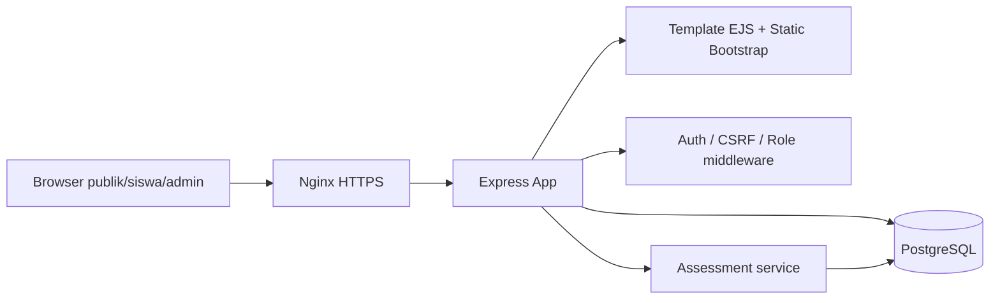

# Arsitektur English LMS (v1)

## Stack & deployment
Browser (Bootstrap 5, CSS, vanilla JS) -> Nginx HTTPS proxy -> Node.js/Express ESM -> PostgreSQL. Cookie session HttpOnly + SameSite=Lax, disimpan dalam PostgreSQL via connect-pg-simple. Tidak memerlukan React, Redis, atau layanan AI eksternal untuk MVP. Deployment utama: LXC Debian 12/13 pada Proxmox; Node.js >=20; PostgreSQL 15+.

## Trust boundaries & keamanan
- Semua materi: GET publik; semua start/answer/submit praktik & exam: login wajib. Admin CRUD: middleware admin.
- Backend menentukan jawaban benar. `options_snapshot` yang dikirim ke klien hanya id+teks, tanpa `is_correct` atau `correct_option_id`; nilai keluar setelah submitted/expired. Token anti-CSRF diperiksa untuk POST termasuk JSON fetch.
- Password bcrypt (cost 12), username lowercase, session cookie HttpOnly, SameSite=Lax, secure pada HTTPS. Regenerasi session saat masuk. Rate limit auth, input validation di server, parameterized query.
- Deadline exam diverifikasi menggunakan waktu PostgreSQL/Node saat GET, POST answer, dan submission. Refresh tidak mengganti pertanyaan, posisi, urutan opsi, atau jawaban yang telah tersimpan.
- HTTPS wajib untuk produksi; atur `TRUST_PROXY=1`, `COOKIE_SECURE=true`, `NODE_ENV=production` hanya setelah Nginx benar-benar meneruskan X-Forwarded-Proto.
- Password admin pertama berasal dari environment saat seed. Jangan commit `.env`/backup/database pribadi ke Git.

## Alur
1. Anonymous: Home -> Course Catalog -> Module -> Public lesson -> Login/Register CTA untuk Practice/Exam.
2. Student: Dashboard -> Practice setup (10 soal per modul atau subtopik) -> question set (random, mengurangi soal yang baru dilihat) -> jawaban tersimpan realtime -> pembahasan langsung dalam Practice -> submit -> hasil, history.
3. Student: Exam setup -> ambil jumlah soal, durasi, KKM dari exam_configs -> snapshot pertanyaan disimpan -> timed exam -> submit/expired -> nilai & pembahasan setelah exam berakhir.
4. Admin: dashboard -> list materi -> edit Markdown; bank soal -> create/edit/toggle MCQ; Exam config -> atur jumlah/durasi/KKM.

## Data consistency
- `questions` adalah master bank. `question_options` tepat 4 opsi dan 1 benar (ditegakkan oleh aplikasi; unique partial index menjaga paling banyak satu benar).
- `attempt_items` menyimpan snapshot saat sesi dibuat sehingga edit soal selanjutnya tidak mengubah hasil sebelumnya.
- Pilihan opsi dipilih dengan shuffle Fisher-Yates dan disimpan ke snapshot. Semua penyimpanan skor dilakukan server-side dalam transaksi memakai row lock.
- Histori soal yang pernah dikerjakan diperhitungkan lewat sort jumlah kemunculan sebelumnya untuk mengurangi pengulangan. Kalau pool terlalu kecil, sistem mengembalikan jumlah yang tersedia, tidak mengada-adakan.

## Diagram arsitektur

## Endpoints (v1)
| Method | Path | Akses | Fungsi |
|---|---|---|---|
| GET | /, /courses, /courses/:slug | publik | beranda dan katalog |
| GET | /learn/:moduleSlug, /learn/:moduleSlug/:lessonSlug | publik | daftar subtopik dan materi |
| GET/POST | /register, /login | publik | akun siswa, autentikasi |
| POST | /logout | login | keluar |
| GET | /dashboard, /history | login | progres dan riwayat |
| GET/POST | /practice/:moduleSlug | login | set latihan, mulai latihan |
| GET/POST | /exam/:moduleSlug | login | konfigurasi dan mulai exam |
| GET | /attempts/:id/take | pemilik/admin | daftar pertanyaan |
| POST | /attempts/:id/answer | pemilik | autosave per jawaban (JSON) |
| POST | /attempts/:id/submit | pemilik | submit nilai |
| GET | /attempts/:id/result | pemilik | hasil |
| GET | /admin | admin | dashboard |
| GET/POST | /admin/lessons/:id/edit | admin | editor Markdown |
| GET | /admin/questions | admin | daftar soal |
| GET/POST | /admin/questions/new | admin | soal baru |
| GET/POST | /admin/questions/:id/edit | admin | ubah soal |
| POST | /admin/questions/:id/toggle | admin | aktif/nonaktif |
| GET/POST | /admin/exams | admin | pengaturan ujian |

## Roadmap setelah MVP
- Editor WYSIWYG, upload gambar, import CSV/XLSX dengan validasi/preview dan deduplikasi.
- Jenis soal fill-blank, true/false, arrange, short text + jawaban alternatif.
- Exam blueprint lintas modul, bobot per topik, remedial & rekomendasi personal, export analytics.
- Versi soal yang immutable, item response theory / kualitas distractor, audit trail admin, CI/CD, backup terenkripsi.
- Penghasil kandidat soal berbantuan AI dengan approval manusia (bukan membuat jawaban tanpa validasi).
